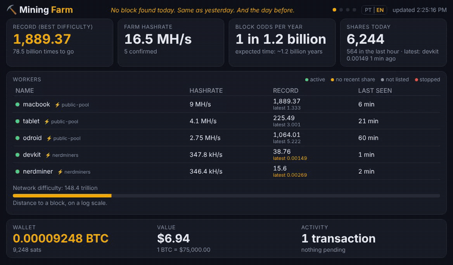
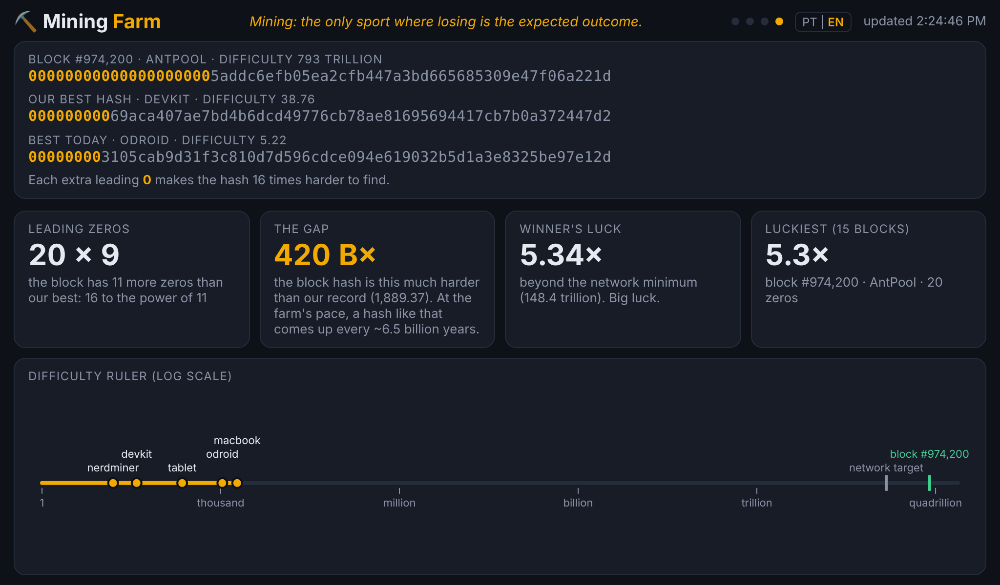
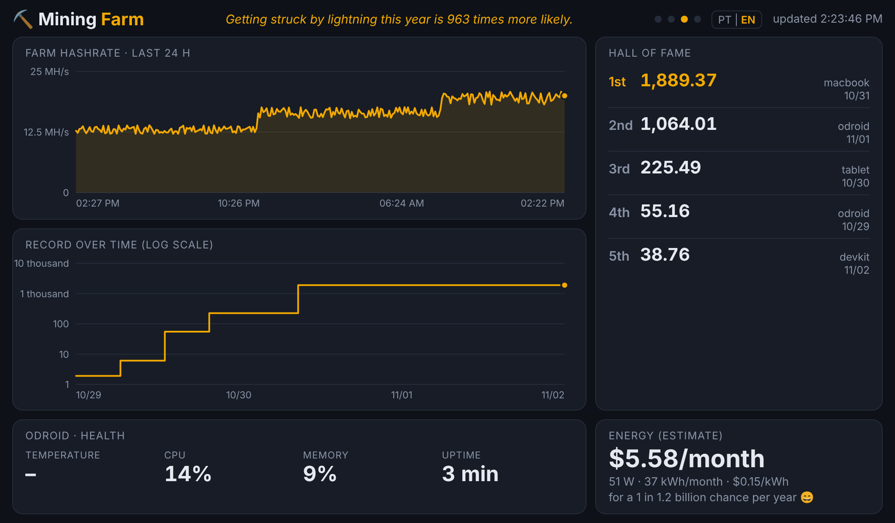
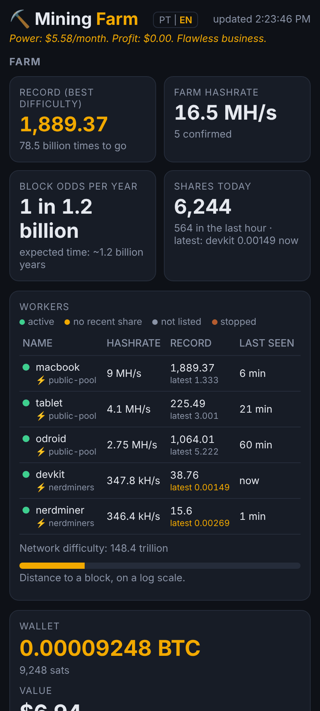
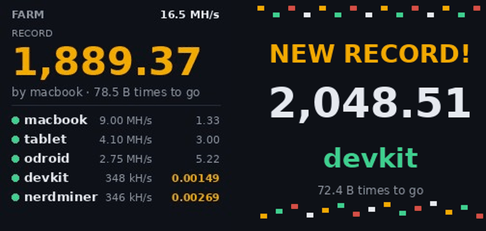

# ⛏️ HomeMinerProxy — Mining Farm

**English** · [Português](README.pt-BR.md)

[](https://github.com/Modanez/HomeMinerProxy/actions/workflows/ci.yml)

A Stratum proxy and dashboard for **home solo mining**: Bitaxe, NerdMiner, ESP32 boards, cpuminer on a laptop or phone. Everything runs on a small computer at home (Odroid, Raspberry Pi, Orange Pi or any Linux box), with **no dependencies** besides Node.js.

The goal is to turn the "block lottery" into something fun to watch: every share shows up instantly, records trigger confetti and a siren, and one screen shows the gap between your best hash and the hash of the latest block on the network.




<details>
<summary>More screenshots</summary>

| Almost a block | History |
|---|---|
|  |  |

| Phone | GeekMagic cube |
|---|---|
|  |  |

The screenshots use demo data.
</details>

## How it works

```
Bitaxe / NerdMiner / cpuminer ──► proxy (port 3333, 3334, 3335…) ──► pool
                                    │
                                    └─► computes each share's difficulty ──► web dashboard, siren, cube
```

- **Stratum proxy** (`src/proxy.js`): each miner connects to your home server instead of the pool. The proxy forwards everything **unchanged** and, on the way, rebuilds each share's block header to compute the difficulty it reached. It works with any pool and any miner, without relying on pool APIs or on the device firmware. The port picks the pool:

  | Port | Pool | Fee |
  |---|---|---|
  | 3333 | public-pool.io | 0% |
  | 3334 | solo.ckpool.org (US) | 2% |
  | 3335 | pool.nerdminers.org | 0% |
  | 3337 | OCEAN (shared payouts, not solo) | see ocean.xyz |
  | 3338 | solo.atlaspool.io (anycast, servers on every continent) | 1.5% of the subsidy |
  | 3339 | eusolo.ckpool.org (Europe) | 2% |

  Any other Stratum V1 pool can be added with `PROXY_ROUTES` (see the configuration).

  **Failover:** most ports have a backup pool. If the main pool stops answering, miners that connect are sent to the backup, and the dashboard shows a warning. A health check retests the main pool every minute; when it recovers, miners move back to it. Backups always pay the same address, since the username your miner sends is passed through unchanged.

- **Dashboard** (`src/painel.js`), at `http://SERVER-IP:3000`, with five screens:
  - **Farm:** records, hashrate, and the worker list with each worker's latest share.
  - **Bitcoin network:** latest block, difficulty adjustment, halving, and the prize at stake.
  - **History:** charts, hall of fame, and power cost.
  - **Almost a block:** your best hash vs. the latest block hash, leading zeros side by side. The 🎟️ button turns today's best hash into a lottery-ticket image ("NOT A WINNER", until the day it is) to share or save.
  - **Luck:** each worker's best share compared with what its work should statistically produce (1× is normal, 2× is twice as lucky), a histogram of all share difficulties against the theoretical curve, the **Weekly Championship** (ranked by relative luck so an ESP32/devkit can beat an ASIC), and **Farm Achievements**.

  For a screen attached to the server, use `?kiosk`: screens rotate on their own and the cursor is hidden.
- **Optional extras:**
  - **Telegram bot:** alerts on your phone for farm records, stopped workers, pool failover and money arriving in the wallet (a found block!), a daily summary, and commands such as `/status` and `/luck`. See [Telegram bot](#telegram-bot-optional).
  - **Siren:** an Arduino with LEDs and a speaker, see `extras/sirene`.
  - **GeekMagic SmallTV cube:** a 240×240 desk scoreboard (`src/cubo.py`).
  - **KWGT widget for Android:** see `extras/kwgt`.

## Settings screen

The ⚙️ button at the top of the dashboard (or `http://SERVER-IP:3000/config`) changes the everyday options without editing files: bitcoin address, language, currency, kWh price, whether to show the wallet balance, the miner running on the server (`LOCAL_WORKER`), workers that don't trigger the red light (`ALARM_IGNORE`), power draw (`WATTS`) and expected hashrate (`EXPECTED`) per worker, the cube IP and the Telegram bot. It has buttons to test the cube, send a Telegram test message, and **download or restore a full backup** (settings, records, history and workers in a single JSON file).

- **PIN:** saving asks for the `SETTINGS_PIN`. `install.sh` creates it, shows it at the end, and keeps it in `/etc/mineracao.env`. With Docker, set `SETTINGS_PIN` in `mineracao.env` yourself.
- **Where it is saved:** in `settings.json`, next to the records and history. It takes priority over `/etc/mineracao.env`; anything you don't change on the screen still comes from the file.
- **Applying:** after saving, the dashboard restarts by itself and open pages reload. The cube notices the change and restarts too.

## Languages

The dashboard, cube, widget and installer work in **English** and **Brazilian Portuguese (pt-BR)**.

- **`LANGUAGE=en`** or **`LANGUAGE=pt-BR`** in `/etc/mineracao.env` sets the language. When empty, the dashboard follows the browser, and the cube and widget use English.
- The **PT | EN** button at the top of the dashboard switches the language and remembers the choice in that browser.
- **`?lang=en`** or **`?lang=pt`** on the dashboard or widget URL overrides the language for that page only.
- **`CURRENCY=USD`** or **`CURRENCY=BRL`** sets the currency for money values (BTC price, prize, power bill). The default is BRL for pt-BR and USD otherwise.
- **`POWER_PRICE_KWH=0.15`** sets your electricity price per kWh, in that currency (default 0.15 USD or 0.90 BRL). Together with `WATTS` per worker, it drives the power bill estimate.

## Install

Requires Linux with systemd and Node.js 16 or newer.

```bash
git clone https://github.com/Modanez/HomeMinerProxy.git
cd HomeMinerProxy
sudo bash install.sh
```

On first run the installer asks for your miners' bitcoin address and creates `/etc/mineracao.env`. Every option is documented in `config/mineracao.env.example`. After editing:

```bash
sudo systemctl restart mineracao-proxy mineracao-painel
```

To update, run `git pull && sudo bash install.sh` again. Your configuration and data (records, history) are kept.

### With Docker

```bash
git clone https://github.com/Modanez/HomeMinerProxy.git
cd HomeMinerProxy
cp config/mineracao.env.example mineracao.env   # set BTC_ADDRESS, and LANGUAGE / TZ if you like
docker compose up -d
```

The dashboard is at `http://SERVER-IP:3000` and the proxy ports are the same as above. Data (records, history) lives in the `data` volume. To update: `git pull && docker compose up -d --build`.

- **GeekMagic cube:** set `CUBE_IP` and run `docker compose --profile cubo up -d`.
- **Settings screen:** set `SETTINGS_PIN` in `mineracao.env` to be able to save it.
- **Arduino siren:** uncomment the `devices` lines of the `painel` service in `compose.yaml`.
- **cpuminer on the same machine (`LOCAL_WORKER`):** not available inside the container, because it reads the host's systemd journal. The worker still shows up through the proxy.

## Which pool for which miner?

| Miner | Hashrate | Recommended port | Why |
|---|---|---|---|
| NerdMiner, ESP32 boards | ~50–400 kH/s | **3335** nerdminers | Accepts their tiny share difficulty. Most other pools reject them ("difficulty too low") |
| cpuminer on a PC, phone or SBC | ~1–20 MH/s | **3333** public-pool | No fee and a minimum difficulty of 1 |
| Bitaxe and other small ASICs | ~0.4–10 TH/s | **3334** ckpool or **3338** atlaspool | Proven solo pools. Pick the one with lower latency where you live. The proxy counts accepted and rejected shares per worker (`curl localhost:3336/stats` on the server), so you can compare |
| Any miner, in Europe | | **3339** ckpool EU | Same pool as 3334, closer servers |
| You want small, regular payouts instead of the lottery | | **3337** OCEAN | Not solo: rewards are shared among all miners |

AtlasPool requires a minimum difficulty of 2,000 (around 400 GH/s), so ESP32 miners do not work there.

## Pointing your miners

Username: `YOUR_ADDRESS.worker-name`, any password (e.g. `x`). The name after the dot is what shows on the dashboard.

| Miner | Pool | Port |
|---|---|---|
| cpuminer (`minerd`), [step by step](#mining-with-cpuminer-step-by-step) | `stratum+tcp://SERVER-IP` | 3333 |
| NerdMiner / ESP32 | `SERVER-IP` | 3335 |
| Bitaxe | `SERVER-IP` | 3334 (set `solo.ckpool.org:3333` as the fallback pool in AxeOS) |

Give the server a fixed IP in your router (DHCP reservation): if its IP changes, every miner loses its pool.

```bash
minerd -a sha256d -o stratum+tcp://192.168.0.10:3333 -u YOUR_ADDRESS.laptop -p x
```

## Mining with cpuminer (step by step)

[cpuminer](https://github.com/pooler/cpuminer) (`minerd`) mines Bitcoin on any CPU: a laptop, an old PC, a Raspberry Pi, an Android phone. Be honest with yourself about the odds: a CPU makes a few MH/s, so a block is a one-in-billions-per-year lottery. It is fun because every share shows up on the dashboard, records included. On this project's farm, a MacBook M2 makes about 9 MH/s, an Android tablet about 4 MH/s and an Odroid-C2 about 2.7 MH/s.

Use port **3333** (public-pool, minimum difficulty 1). In the commands below, replace `SERVER-IP` with the IP of the machine running the proxy, `YOUR_ADDRESS` with your bitcoin address, and `laptop` with the name you want on the dashboard.

<details>
<summary><b>Linux</b> (Ubuntu, Debian, Armbian, Raspberry Pi OS)</summary>

```bash
sudo apt install -y git build-essential automake autoconf pkg-config libcurl4-openssl-dev
git clone https://github.com/pooler/cpuminer.git
cd cpuminer
./autogen.sh
./configure CFLAGS="-O3"
make -j"$(nproc)"
sudo make install        # installs /usr/local/bin/minerd
minerd -a sha256d -o stratum+tcp://SERVER-IP:3333 -u YOUR_ADDRESS.laptop -p x
```

**Run it as a service** (starts at boot, restarts on failure), for example on the same machine as the dashboard. Create `/etc/systemd/system/minerd.service`:

```ini
[Unit]
Description=cpuminer
After=network-online.target mineracao-proxy.service
Wants=network-online.target

[Service]
ExecStart=/usr/local/bin/minerd -a sha256d -o stratum+tcp://127.0.0.1:3333 -u YOUR_ADDRESS.odroid -p x
Nice=19
Restart=always
RestartSec=30

[Install]
WantedBy=multi-user.target
```

Then `sudo systemctl daemon-reload && sudo systemctl enable --now minerd`. If the service is called `minerd` and runs on the dashboard machine, set `LOCAL_WORKER=odroid` (the worker name) in `/etc/mineracao.env`: the dashboard reads the hashrate straight from its log and shows the CPU temperature next to it.
</details>

<details>
<summary><b>macOS</b> (Intel or Apple Silicon)</summary>

Install [Homebrew](https://brew.sh) first, then:

```bash
xcode-select --install   # compilers, if you don't have them yet
brew install git automake autoconf pkg-config curl
git clone https://github.com/pooler/cpuminer.git
cd cpuminer
./autogen.sh
./nomacro.pl             # needed with Clang, the macOS compiler
./configure CFLAGS="-O3"
make -j"$(sysctl -n hw.ncpu)"
caffeinate -i ./minerd -a sha256d -o stratum+tcp://SERVER-IP:3333 -u YOUR_ADDRESS.macbook -p x
```

`caffeinate -i` keeps the Mac awake while it mines. Close the terminal (or press Ctrl+C) to stop.
</details>

<details>
<summary><b>Android</b> (Termux)</summary>

Install **Termux from F-Droid** (the Play Store version is outdated), then:

```bash
pkg update
pkg install -y git clang make automake autoconf pkg-config libcurl
git clone https://github.com/pooler/cpuminer.git
cd cpuminer
./autogen.sh
./nomacro.pl
./configure CFLAGS="-O3"
make -j"$(nproc)"
termux-wake-lock         # keeps the CPU awake with the screen off
./minerd -a sha256d -o stratum+tcp://SERVER-IP:3333 -u YOUR_ADDRESS.phone -p x
```

In Android settings, set Termux's battery usage to **Unrestricted**, otherwise the system kills the miner after a while. Keep the device on the charger and somewhere it can cool down.
</details>

<details>
<summary><b>Windows</b></summary>

Download the prebuilt Windows version (`pooler-cpuminer-2.5.1-win64.zip`) from the project's [SourceForge page](https://sourceforge.net/projects/cpuminer/files/), extract it, open a terminal in that folder and run:

```bat
minerd.exe -a sha256d -o stratum+tcp://SERVER-IP:3333 -u YOUR_ADDRESS.pc -p x
```

The antivirus may flag any miner as unwanted software. If it does, allow that folder only.
</details>

**Useful options**
- `-t 2` uses only 2 threads (the default is every core). This keeps the machine responsive and cooler.
- `-q` hides the per-thread hashrate lines. Do not use it with `LOCAL_WORKER`, because the dashboard reads those lines.
- `-R 10` waits 10 seconds before reconnecting after a network error (the default is 30). By default it retries forever, which is what you want.

**Check that it worked:** within a minute, `minerd` prints `accepted: 1/1 (100.00%)` and, on the dashboard, the worker appears with ⚡ (connected through the proxy). A CPU at a few MH/s needs some minutes per share at difficulty 1, so the first one can take a while.

## Telegram bot (optional)

1. In Telegram, open **@BotFather**, send `/newbot`, pick a name and copy the token it gives you.
2. Put it in `/etc/mineracao.env` as `TELEGRAM_BOT_TOKEN=...` and run `sudo systemctl restart mineracao-painel`.
3. Send `/start` to your bot. It replies with your chat id.
4. Put that id in `TELEGRAM_CHAT_ID=...` and restart the dashboard again.

The bot sends:
- **Farm record:** a new best share for the whole farm.
- **Worker stopped / back:** when a worker goes red on the dashboard, and when it returns.
- **Pool failover:** when a port moves to its backup pool, and when it moves back.
- **Money in the wallet:** any payment to your address. A solo block shows up as 🎉 **WE FOUND A BLOCK!**
- **Achievements:** real-time alerts when the farm unlocks a new milestone (e.g. first 1k difficulty share, 100k shares, 7 days nonstop, or the underdog trophy).
- **Daily summary:** at 21:00 by default (`TELEGRAM_DAILY`), with today's lottery ticket image attached (and the weekly champion announced on Sundays).

Commands: `/status`, `/workers`, `/luck`, `/records`, `/championship`, `/achievements`, `/plug` (`on`/`off`/`reboot`), `/ticket` (today's ticket image), `/help`. The ticket image needs Python with Pillow on the server (the installer adds it; the Docker image has it); without it, the summary goes as text only. The bot answers only the chats in `TELEGRAM_CHAT_ID`. It uses long polling, so nothing on your network needs to be exposed. During `QUIET_HOURS` the alerts arrive without sound.

## GeekMagic cube (optional)

Set `CUBE_IP` in `/etc/mineracao.env` and run `install.sh` again. The scoreboard refreshes every 5 minutes, and a new record shows up right away on a "NEW RECORD!" screen. The cube must run the original GeekMagic firmware, which has the photo album mode.

## Smart Plug — SmartLife / Tuya (optional)

If your miner (or a fan while you wait for your Bitaxe) is plugged into a **SmartLife / Tuya** Wi-Fi smart plug with energy monitoring, you can connect it directly on the Settings screen (`/config`) or in `/etc/mineracao.env`:

1. Create a free account at [iot.tuya.com](https://iot.tuya.com) -> **Cloud** -> **Development** -> **Create Cloud Project** (Data Center: **Western America** for Brazil/Americas).
2. Under **Link Tuya App Account**, scan the QR code with your **SmartLife** app (*Me -> top-right scan icon*) and authorize **IoT Core** in Service API.
3. Paste `TUYA_CLIENT_ID`, `TUYA_SECRET`, and `TUYA_DEVICE_ID` on `/config` and click **Test plug**.
4. Choose `TUYA_WORKER`:
   - **Monitor only**: displays live Watts, Volts, and on/off state on the History/Power card without adding the plug's watts to the miners' power bill (great when monitoring a fan or other device).
   - **Specific worker (e.g. `bitaxe`) or Whole farm (`*`)**: replaces the static `WATTS` estimate with the real live measurement from the smart plug.
5. Control it from Telegram (`/plug`, `/plug on`, `/plug off`, `/plug reboot`) or set `TUYA_WATCHDOG_MIN` (e.g. `30`) to automatically power-cycle the plug if the miner goes 30 minutes without shares.

## Home Assistant / MQTT (optional)

Set `MQTT_URL` (e.g. `mqtt://homeassistant.local:1883` or `mqtts://host:8883`), `MQTT_USER`, `MQTT_PASS`, and `MQTT_TOPIC` (default: `homeminerproxy`) in `/etc/mineracao.env` or on the Settings screen (`/config`).

- **Zero-YAML Auto-Discovery:** publishes 11 sensors (`hashrate`, `best_difficulty`, `best_worker`, `workers_active`, `workers_stopped`, `shares_today`, `power_watts`, `energy_kwh_month`, `cost_month`, `weekly_leader`, `achievements_unlocked`) and 1 `pool_failover` binary sensor under `homeassistant/.../config`, automatically creating the **Mining Farm** device in Home Assistant (including power/energy/monetary classes for the Home Assistant Energy Dashboard).
- **State & per-worker topics:** publishes `<prefix>/state` and `<prefix>/worker/<name>` (retained JSON), plus `<prefix>/availability` (`online` / `offline` with Last Will & Testament).
- **Instant events (`<prefix>/event`):** publishes non-retained JSON events (`farm_record`, `personal_record`, `worker_offline`, `worker_online`, `pool_failover`, `pool_recovered`, `wallet_received`, `block_found`, `achievement_unlocked`) to trigger smart plugs, WLED/Hue lights, AWTRIX desk clocks, or voice assistants.

## Development

```bash
npm run check   # syntax of everything
npm test        # tests (Node 18+ and Python 3; cube tests need Pillow)
```

What the tests cover:
- **Share math:** checked against the real **genesis block** and **block 1**. If the byte order were wrong, the hash would not match.
- **Proxy:** runs between a fake pool and a test miner.
- **Dashboard:** starts with no internet access.
- **Translation:** covers the whole page.

The page text lives in Portuguese in the source code. The English version is generated from the table in `src/i18n.js`. If you change a Portuguese string, update the table: `tests/i18n.test.js` fails when an entry no longer matches.

Architecture & API documentation:
- **C4 Model (Context, Containers, Components & Flows):** [`docs/c4/README.md`](docs/c4/README.md)
- **Architecture Decision Records (ADRs):** [`docs/adr/README.md`](docs/adr/README.md)
- **Postman Collections (HTTP APIs):** [`docs/postman/README.md`](docs/postman/README.md)

## Security

- Use your **public** bitcoin address only. Nothing in this project asks for a seed or private key.
- The proxy ports (3333–3339) and the dashboard (3000) are meant for your home network. Do not expose them to the internet. For remote access, prefer a VPN such as Tailscale. Raw stats (`3336`) listen on `127.0.0.1` only.

## Support the project

If this project made your block lottery more fun, donations are welcome. ⚡

**Bitcoin (on-chain):** `bc1qstq0tx86kwgskzxte0l7a6ewtyp0y4z8w4jd2w`

Issues, ideas and pull requests are also very welcome.

## License

MIT
