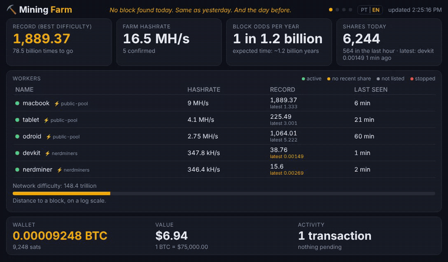
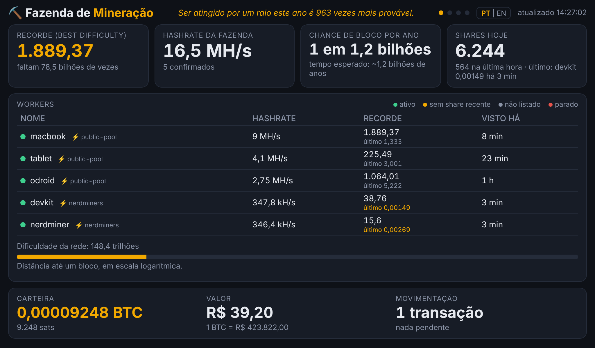
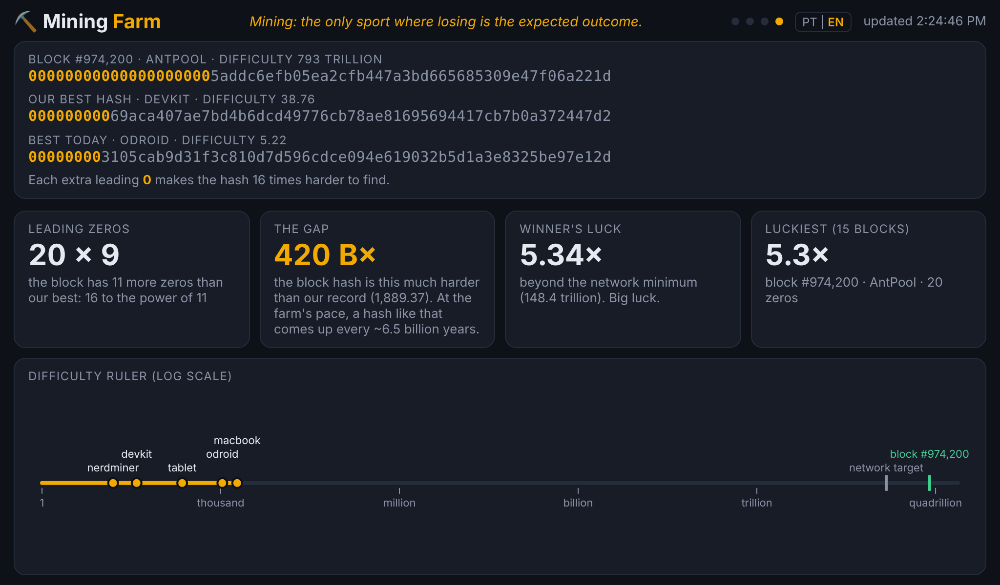
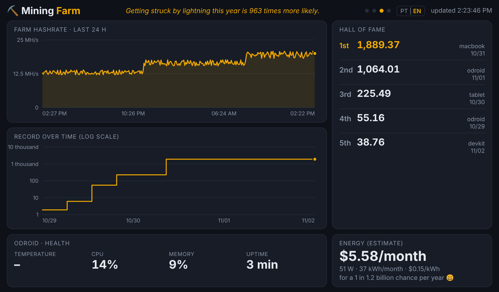
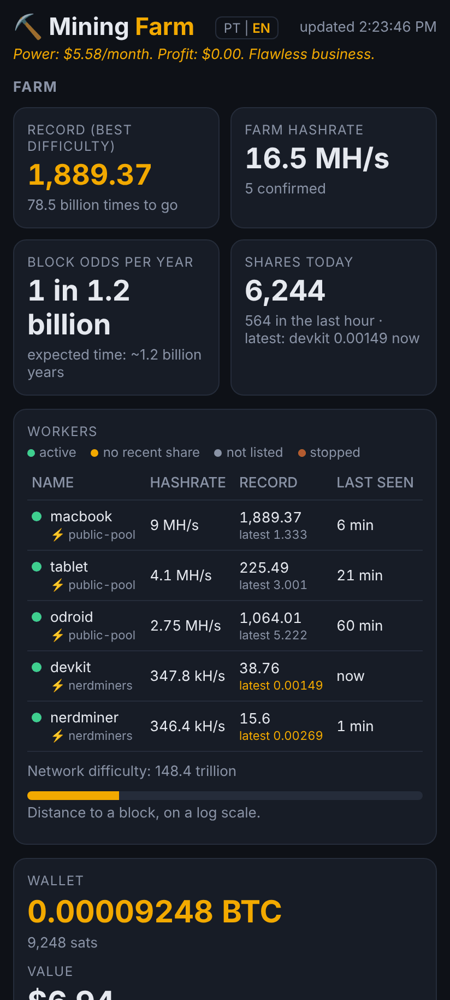
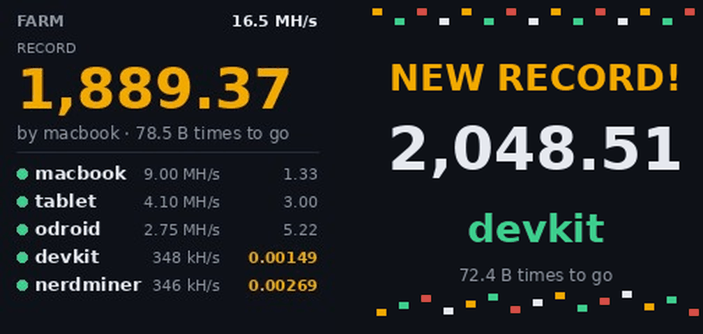

# ⛏️ Fazenda de Mineração (HomeMinerProxy)

[English](README.md) · **Português**

[](https://github.com/Modanez/HomeMinerProxy/actions/workflows/ci.yml)

Proxy Stratum e painel para **mineração solo caseira**: Bitaxe, NerdMiner, ESP32, cpuminer no notebook ou no celular. Tudo roda num computador pequeno da casa (Odroid, Raspberry Pi, Orange Pi ou qualquer Linux), **sem dependências** além do Node.js.

A ideia é transformar a "loteria do bloco" em algo divertido de acompanhar: cada share aparece na hora, os recordes disparam confete e sirene, e uma tela mostra o abismo entre o nosso melhor hash e o hash do último bloco da rede.





<details>
<summary>Mais imagens</summary>

| Quase bloco | Histórico |
|---|---|
|  |  |

| Celular | Cubo GeekMagic |
|---|---|
|  |  |

As imagens usam dados de demonstração. As telas extras estão em inglês; o painel inteiro também funciona em português.
</details>

## Como funciona

```
Bitaxe / NerdMiner / cpuminer ──► proxy (porta 3333, 3334, 3335…) ──► pool
                                    │
                                    └─► calcula a dificuldade de cada share ──► painel web, sirene, cubo
```

- **Proxy Stratum** (`src/proxy.js`): cada minerador se conecta no servidor da casa em vez da pool. O proxy repassa tudo **sem alterar nada** e, no caminho, remonta o cabeçalho do bloco de cada share para calcular a dificuldade atingida. Funciona com qualquer pool e qualquer minerador, sem depender de API de pool nem do firmware do aparelho. A porta escolhe a pool:

  | Porta | Pool | Taxa |
  |---|---|---|
  | 3333 | public-pool.io | 0% |
  | 3334 | solo.ckpool.org (EUA) | 2% |
  | 3335 | pool.nerdminers.org | 0% |
  | 3337 | OCEAN (pagamento dividido, não é solo) | ver ocean.xyz |
  | 3338 | solo.atlaspool.io (anycast, com servidor em São Paulo) | 1,5% do subsídio |
  | 3339 | eusolo.ckpool.org (Europa) | 2% |

  Qualquer outra pool Stratum V1 pode ser acrescentada no `PROXY_ROUTES` (veja a configuração).

  **Failover:** a maioria das portas tem uma pool reserva. Se a pool principal parar de responder, os mineradores que se conectarem vão para a reserva, e o painel mostra um aviso. Uma checagem testa a principal a cada minuto; quando ela volta, os mineradores voltam junto. A reserva sempre paga o mesmo endereço, porque o usuário que o minerador envia passa sem alteração.

- **Painel** (`src/painel.js`), em `http://IP-DO-SERVIDOR:3000`, com cinco telas:
  - **Fazenda:** recordes, hashrate e a lista de workers com o último share.
  - **Rede Bitcoin:** último bloco, ajuste de dificuldade, halving e prêmio em jogo.
  - **Histórico:** gráficos, hall da fama e consumo de energia.
  - **Quase bloco:** nosso melhor hash × hash do último bloco, com os zeros lado a lado. O botão 🎟️ transforma o melhor hash do dia num bilhete de loteria ("NÃO PREMIADO", até o dia em que for) para compartilhar ou salvar.
  - **Sorte:** o melhor share de cada worker comparado com o que o trabalho dele deveria render pela estatística (1× é o normal, 2× é o dobro de sorte), e um histograma das dificuldades de todos os shares contra a curva teórica. Uma diferença grande da curva pode indicar problema no minerador ou na pool.

  Para uma tela ligada ao servidor, use `?kiosk`: as telas alternam sozinhas e o cursor some.
- **Extras opcionais:**
  - **Bot do Telegram:** avisos no celular de recorde da fazenda, worker parado, failover de pool e dinheiro entrando na carteira (um bloco achado!), resumo diário e comandos como `/status` e `/sorte`. Veja [Bot do Telegram](#bot-do-telegram-opcional).
  - **Sirene:** Arduino com LEDs e alto-falante, ver `extras/sirene`.
  - **Cubo GeekMagic SmallTV:** placar de 240×240 na mesa (`src/cubo.py`).
  - **Widget KWGT para Android:** ver `extras/kwgt`.

## Tela de configurações

O botão ⚙️ no topo do painel (ou `http://IP-DO-SERVIDOR:3000/config`) muda as opções do dia a dia sem editar arquivo: endereço de bitcoin, idioma, moeda, preço do kWh, o minerador que roda no servidor (`LOCAL_WORKER`), os workers que não acendem a luz vermelha (`ALARM_IGNORE`), o consumo em watts (`WATTS`) e o hashrate esperado (`EXPECTED`) de cada worker, o IP do cubo e o bot do Telegram. Tem botões para testar o cubo, mandar uma mensagem de teste no Telegram e **baixar ou restaurar um backup completo** (configurações, recordes, histórico e workers num arquivo JSON único).

- **PIN:** para salvar, a tela pede o `SETTINGS_PIN`. O `install.sh` cria um, mostra no final e guarda em `/etc/mineracao.env`. No Docker, defina o `SETTINGS_PIN` no `mineracao.env`.
- **Onde fica salvo:** em `settings.json`, junto com os recordes e o histórico. Ele vale por cima do `/etc/mineracao.env`; o que você não mudar na tela continua vindo do arquivo.
- **Para aplicar:** depois de salvar, o painel reinicia sozinho e as páginas abertas recarregam. O cubo percebe a mudança e reinicia também.

## Idiomas

O painel, o cubo, o widget e o instalador funcionam em **português (pt-BR)** e **inglês**.

- **`LANGUAGE=pt-BR`** em `/etc/mineracao.env` fixa o idioma. Vazio, o painel segue o idioma do navegador, e o cubo e o widget ficam em inglês.
- O botão **PT | EN** no topo do painel troca o idioma e lembra a escolha naquele navegador.
- **`?lang=pt` ou `?lang=en`** na URL do painel ou do widget força o idioma só ali.
- **`CURRENCY=BRL`** ou **`CURRENCY=USD`** define a moeda dos valores (cotação, prêmio, conta de luz). O padrão é BRL em pt-BR e USD nos outros casos.
- **`POWER_PRICE_KWH=0.90`** define o preço do kWh da sua conta de luz, nessa moeda. O padrão é R$ 0,90 ou US$ 0,15. Junto com o `WATTS` de cada worker, ele calcula a estimativa da conta de luz.

## Instalação

Precisa de Linux com systemd e Node.js 16 ou mais novo.

```bash
git clone https://github.com/Modanez/HomeMinerProxy.git
cd HomeMinerProxy
sudo LANGUAGE=pt-BR bash install.sh
```

Na primeira vez, o instalador pergunta o endereço de bitcoin dos mineradores e cria `/etc/mineracao.env`. Todas as opções estão comentadas em `config/mineracao.env.example`. Depois de editar:

```bash
sudo systemctl restart mineracao-proxy mineracao-painel
```

Para atualizar, rode `git pull && sudo bash install.sh` de novo. A configuração e os dados (recordes, histórico) são mantidos.

### Com Docker

```bash
git clone https://github.com/Modanez/HomeMinerProxy.git
cd HomeMinerProxy
cp config/mineracao.env.example mineracao.env   # preencha BTC_ADDRESS e, se quiser, LANGUAGE=pt-BR e TZ=America/Sao_Paulo
docker compose up -d
```

O painel fica em `http://IP-DO-SERVIDOR:3000`, e as portas do proxy são as mesmas de cima. Os dados (recordes, histórico) ficam no volume `data`. Para atualizar: `git pull && docker compose up -d --build`.

- **Cubo GeekMagic:** preencha `CUBE_IP` e rode `docker compose --profile cubo up -d`.
- **Tela de configurações:** defina `SETTINGS_PIN` no `mineracao.env` para poder salvar.
- **Sirene do Arduino:** descomente as linhas `devices` do serviço `painel` no `compose.yaml`.
- **cpuminer na mesma máquina (`LOCAL_WORKER`):** não funciona dentro do contêiner, porque essa função lê o journal do systemd da máquina. O worker continua aparecendo pelo proxy.

## Qual pool para cada minerador?

| Minerador | Hashrate | Porta recomendada | Por quê |
|---|---|---|---|
| NerdMiner, placas ESP32 | ~50–400 kH/s | **3335** nerdminers | Aceita a dificuldade minúscula dos shares deles. A maioria das outras pools recusa ("difficulty too low") |
| cpuminer no PC, celular ou placa tipo Raspberry | ~1–20 MH/s | **3333** public-pool | Sem taxa e com dificuldade mínima 1 |
| Bitaxe e outros ASICs pequenos | ~0,4–10 TH/s | **3334** ckpool ou **3338** atlaspool | Pools solo consagradas. Escolha a de menor latência onde você mora. O proxy conta os shares aceitos e recusados de cada worker (`curl localhost:3336/stats` no servidor), então dá para comparar. No Brasil, a AtlasPool tem servidor em São Paulo |
| Qualquer minerador, na Europa | | **3339** ckpool EU | A mesma pool da 3334, com servidores mais perto |
| Você prefere pagamentos pequenos e regulares em vez da loteria | | **3337** OCEAN | Não é solo: a recompensa é dividida entre todos |

A AtlasPool exige dificuldade mínima de 2.000 (uns 400 GH/s), então ESP32 não funciona lá.

## Apontando os mineradores

Usuário: `SEU_ENDERECO.nome-do-worker`, com qualquer senha (ex.: `x`). O nome depois do ponto é o que aparece no painel.

| Minerador | Pool | Porta |
|---|---|---|
| cpuminer (`minerd`), [passo a passo](#minerando-com-o-cpuminer-passo-a-passo) | `stratum+tcp://IP-DO-SERVIDOR` | 3333 |
| NerdMiner / ESP32 | `IP-DO-SERVIDOR` | 3335 |
| Bitaxe | `IP-DO-SERVIDOR` | 3334 (configure `solo.ckpool.org:3333` como pool reserva no AxeOS) |

Reserve um IP fixo para o servidor no roteador (DHCP estático): se o IP mudar, todos os mineradores perdem a pool.

```bash
minerd -a sha256d -o stratum+tcp://192.168.0.10:3333 -u SEU_ENDERECO.notebook -p x
```

## Minerando com o cpuminer (passo a passo)

O [cpuminer](https://github.com/pooler/cpuminer) (`minerd`) minera bitcoin em qualquer processador: notebook, PC velho, Raspberry Pi, celular Android. Seja honesto com as chances: uma CPU faz poucos MH/s, então um bloco é uma loteria de uma em bilhões por ano. A graça é ver cada share aparecer no painel, com direito a recorde. Na fazenda deste projeto, um MacBook M2 faz uns 9 MH/s, um tablet Android uns 4 MH/s e um Odroid-C2 uns 2,7 MH/s.

Use a porta **3333** (public-pool, dificuldade mínima 1). Nos comandos abaixo, troque `IP-DO-SERVIDOR` pelo IP da máquina que roda o proxy, `SEU_ENDERECO` pelo seu endereço de bitcoin e `notebook` pelo nome que você quer ver no painel.

<details>
<summary><b>Linux</b> (Ubuntu, Debian, Armbian, Raspberry Pi OS)</summary>

```bash
sudo apt install -y git build-essential automake autoconf pkg-config libcurl4-openssl-dev
git clone https://github.com/pooler/cpuminer.git
cd cpuminer
./autogen.sh
./configure CFLAGS="-O3"
make -j"$(nproc)"
sudo make install        # instala /usr/local/bin/minerd
minerd -a sha256d -o stratum+tcp://IP-DO-SERVIDOR:3333 -u SEU_ENDERECO.notebook -p x
```

**Rodar como serviço** (sobe no boot e reinicia se cair), por exemplo na mesma máquina do painel. Crie `/etc/systemd/system/minerd.service`:

```ini
[Unit]
Description=cpuminer
After=network-online.target mineracao-proxy.service
Wants=network-online.target

[Service]
ExecStart=/usr/local/bin/minerd -a sha256d -o stratum+tcp://127.0.0.1:3333 -u SEU_ENDERECO.odroid -p x
Nice=19
Restart=always
RestartSec=30

[Install]
WantedBy=multi-user.target
```

Depois rode `sudo systemctl daemon-reload && sudo systemctl enable --now minerd`. Se o serviço se chama `minerd` e roda na máquina do painel, coloque `LOCAL_WORKER=odroid` (o nome do worker) em `/etc/mineracao.env`: o painel lê o hashrate direto do log e mostra a temperatura da CPU ao lado.
</details>

<details>
<summary><b>macOS</b> (Intel ou Apple Silicon)</summary>

Instale o [Homebrew](https://brew.sh) antes e depois rode:

```bash
xcode-select --install   # compiladores, se ainda não tiver
brew install git automake autoconf pkg-config curl
git clone https://github.com/pooler/cpuminer.git
cd cpuminer
./autogen.sh
./nomacro.pl             # necessário com o Clang, o compilador do macOS
./configure CFLAGS="-O3"
make -j"$(sysctl -n hw.ncpu)"
caffeinate -i ./minerd -a sha256d -o stratum+tcp://IP-DO-SERVIDOR:3333 -u SEU_ENDERECO.macbook -p x
```

O `caffeinate -i` impede o Mac de dormir enquanto minera. Para parar, feche o terminal ou aperte Ctrl+C.
</details>

<details>
<summary><b>Android</b> (Termux)</summary>

Instale o **Termux pelo F-Droid** (a versão da Play Store está desatualizada) e rode:

```bash
pkg update
pkg install -y git clang make automake autoconf pkg-config libcurl
git clone https://github.com/pooler/cpuminer.git
cd cpuminer
./autogen.sh
./nomacro.pl
./configure CFLAGS="-O3"
make -j"$(nproc)"
termux-wake-lock         # mantém a CPU acordada com a tela apagada
./minerd -a sha256d -o stratum+tcp://IP-DO-SERVIDOR:3333 -u SEU_ENDERECO.celular -p x
```

Nas configurações do Android, deixe o uso de bateria do Termux como **Sem restrições**, senão o sistema mata o minerador depois de um tempo. Deixe o aparelho no carregador e num lugar onde ele consiga esfriar.
</details>

<details>
<summary><b>Windows</b></summary>

Baixe a versão pronta para Windows (`pooler-cpuminer-2.5.1-win64.zip`) na [página do projeto no SourceForge](https://sourceforge.net/projects/cpuminer/files/), extraia, abra um terminal nessa pasta e rode:

```bat
minerd.exe -a sha256d -o stratum+tcp://IP-DO-SERVIDOR:3333 -u SEU_ENDERECO.pc -p x
```

O antivírus pode marcar qualquer minerador como software indesejado. Se acontecer, libere só essa pasta.
</details>

**Opções úteis**
- `-t 2` usa só 2 threads (o padrão é usar todos os núcleos). Deixa a máquina mais leve e mais fria.
- `-q` esconde as linhas de hashrate de cada thread. Não use com `LOCAL_WORKER`, porque o painel lê essas linhas.
- `-R 10` espera 10 segundos para reconectar depois de um erro de rede (o padrão é 30). Por padrão ele tenta para sempre, que é o que você quer.

**Como saber se funcionou:** o `minerd` mostra `accepted: 1/1 (100.00%)` e, no painel, o worker aparece com ⚡ (conectado pelo proxy). Uma CPU de poucos MH/s leva alguns minutos por share na dificuldade 1, então o primeiro pode demorar.

## Bot do Telegram (opcional)

1. No Telegram, abra o **@BotFather**, mande `/newbot`, escolha um nome e copie o token que ele devolve.
2. Coloque em `/etc/mineracao.env` como `TELEGRAM_BOT_TOKEN=...` e rode `sudo systemctl restart mineracao-painel`.
3. Mande `/start` para o seu bot. Ele responde com o id do chat.
4. Coloque esse id em `TELEGRAM_CHAT_ID=...` e reinicie o painel de novo.

O bot avisa:
- **Recorde da fazenda:** um novo melhor share da fazenda inteira.
- **Worker parado / de volta:** quando um worker fica vermelho no painel, e quando ele volta.
- **Failover de pool:** quando uma porta vai para a pool reserva, e quando volta para a principal.
- **Dinheiro na carteira:** qualquer pagamento para o seu endereço. Um bloco solo chega como 🎉 **ACHAMOS UM BLOCO!**
- **Resumo diário:** às 21h por padrão (`TELEGRAM_DAILY`), com a imagem do bilhete de loteria do dia.

Comandos: `/status`, `/workers`, `/sorte`, `/recordes`, `/bilhete` (imagem do bilhete de hoje), `/ajuda`. A imagem do bilhete precisa de Python com Pillow no servidor (o instalador instala; a imagem Docker já tem); sem isso, o resumo vai só em texto. O bot só responde aos chats do `TELEGRAM_CHAT_ID`. Ele usa long polling, então nada da sua rede precisa ficar exposto. No `QUIET_HOURS`, os avisos chegam sem som.

## Cubo GeekMagic (opcional)

Preencha `CUBE_IP` em `/etc/mineracao.env` e rode o `install.sh` de novo. O placar é atualizado a cada 5 minutos. Um recorde novo aparece na hora, com a tela "NOVO RECORDE!". O cubo precisa estar no firmware original da GeekMagic, que tem o modo álbum de fotos.

## Desenvolvimento

```bash
npm run check   # sintaxe de tudo
npm test        # testes (Node 18+ e Python 3; os do cubo precisam do Pillow)
```

O que os testes cobrem:
- **Matemática do share:** conferida com o **bloco gênese** e o **bloco 1** reais. Se a ordem dos bytes estiver errada, o hash não bate.
- **Proxy:** sobe entre uma pool falsa e um minerador de teste.
- **Painel:** sobe sem acesso à internet.
- **Tradução:** cobre a página inteira.

Os textos da página estão em português no código. A versão em inglês é gerada pela tabela em `src/i18n.js`. Se você mudar um texto em português, atualize a tabela: o teste `tests/i18n.test.js` avisa se algum trecho sumir.

Documentação de arquitetura e APIs:
- **Modelo C4 (Contexto, Contêineres, Componentes e Fluxos):** [`docs/c4/README.pt-BR.md`](docs/c4/README.pt-BR.md)
- **Registros de Decisão de Arquitetura (ADRs):** [`docs/adr/README.pt-BR.md`](docs/adr/README.pt-BR.md)
- **Coleções Postman (APIs HTTP):** [`docs/postman/README.pt-BR.md`](docs/postman/README.pt-BR.md)

## Segurança

- Use só o **endereço público** de bitcoin. Nenhuma parte do projeto pede seed ou chave privada.
- As portas do proxy (3333–3339) e do painel (3000) são para a rede de casa. Não as exponha na internet. Para acesso de fora, prefira uma VPN como Tailscale. As estatísticas brutas (`3336`) só escutam em `127.0.0.1`.

## Apoie o projeto

Se o projeto deixou a sua loteria do bloco mais divertida, doações são bem-vindas. ⚡

**Bitcoin (on-chain):** `bc1qstq0tx86kwgskzxte0l7a6ewtyp0y4z8w4jd2w`

Ideias, issues e pull requests também são muito bem-vindos.

## Licença

MIT
