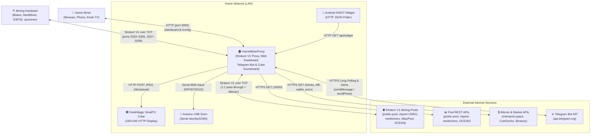
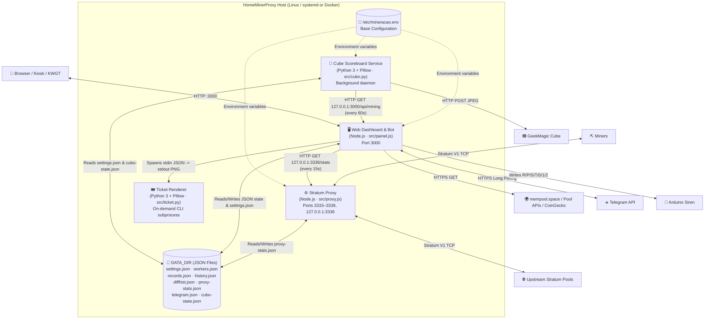
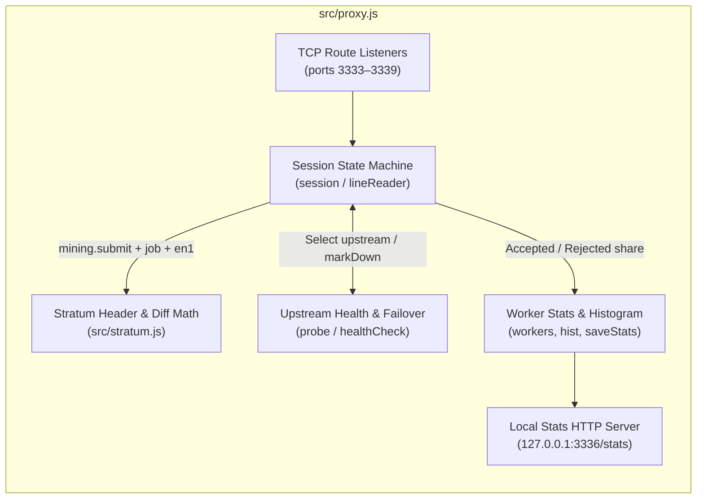
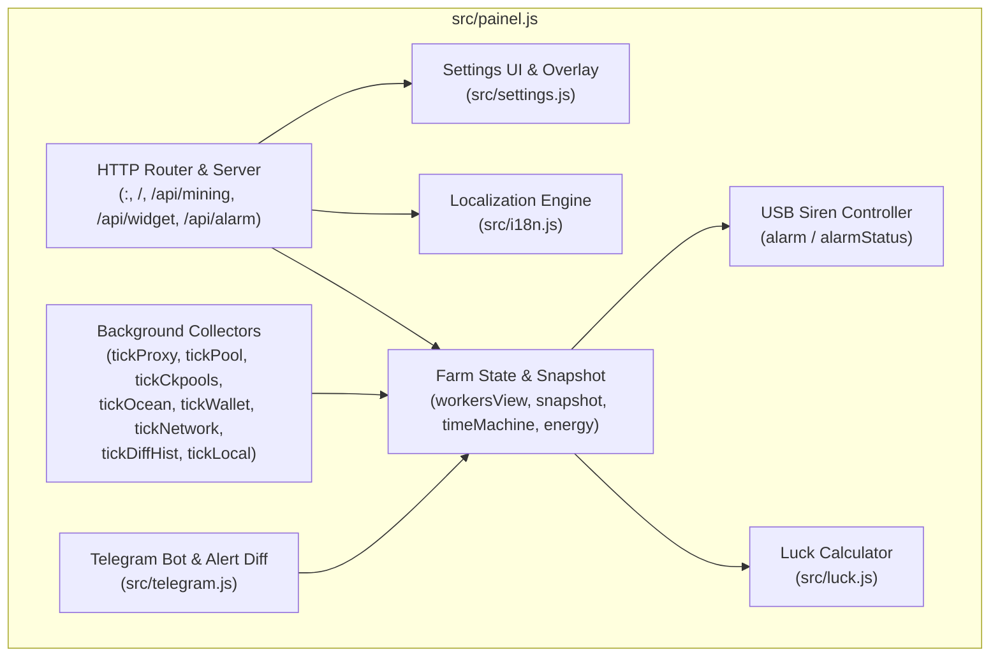
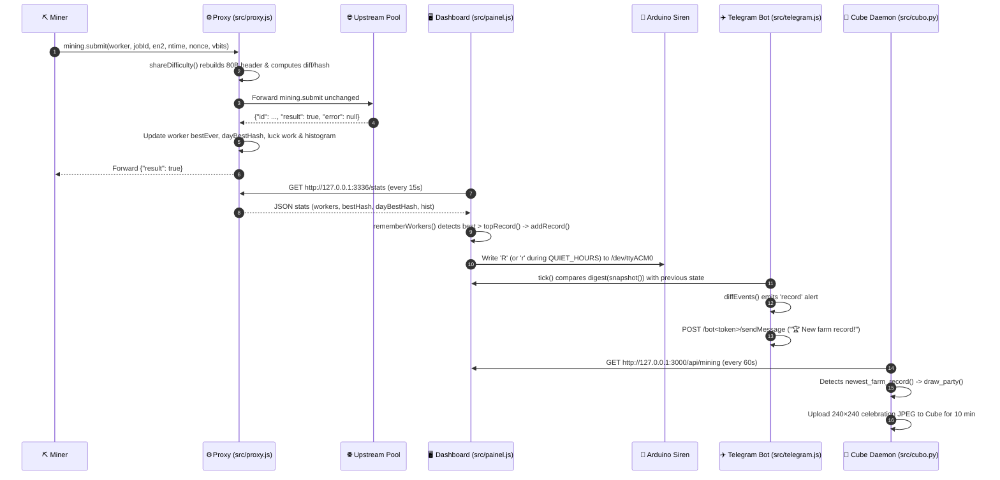
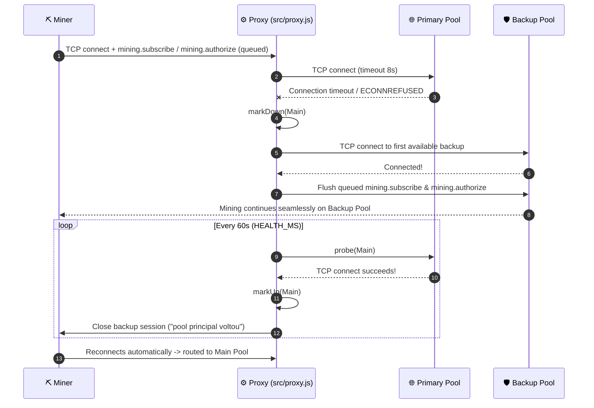

# 🏗️ Architecture — C4 Model (HomeMinerProxy)

**English** · [Português](README.pt-BR.md)

This document describes the architecture of **HomeMinerProxy** using the **C4 Model** (Context, Containers, Components, and Dynamic Flows).

---

## Level 1 — System Context (C1)

At the highest level, **HomeMinerProxy** sits on a small home server (Odroid, Raspberry Pi, Docker host, or any Linux box) between the home mining hardware and external Bitcoin pools/APIs, turning solo mining into an observable, interactive experience.

### External Actors & Systems
| Actor / System | Protocol | Role |
|---|---|---|
| **Home Miner (User)** | HTTP (`:3000`), Telegram | Watches the dashboard (desktop, mobile, or `?kiosk`), edits settings at `/config`, and interacts with the Telegram bot. |
| **Mining Hardware** | Stratum V1 TCP (`:3333–3339`) | Bitaxe, NerdMiner, ESP32, or `cpuminer` (`minerd`) connecting to the local server instead of directly to a pool. |
| **Stratum V1 Pools** | Stratum V1 TCP | Upstream solo/shared pools (`public-pool.io`, `solo.ckpool.org`, `eusolo.ckpool.org`, `pool.nerdminers.org`, `solo.atlaspool.io`, `mine.ocean.xyz`). |
| **Pool REST APIs** | HTTPS JSON | Optional fallback/complement for workers not going through the proxy or for pool-level balances. |
| **Bitcoin & Market APIs** | HTTPS JSON | `mempool.space` (latest blocks, difficulty retarget, fee estimates, historical difficulty, wallet balance) and `CoinGecko` / `Binance` (BTC/USD and BTC/BRL prices). |
| **Telegram Bot API** | HTTPS JSON / Multipart | Receives commands via long polling (`getUpdates`) and delivers alerts and daily lottery-ticket PNGs (`sendMessage`, `sendPhoto`). |
| **GeekMagic SmallTV Cube** | HTTP (`:80`) | 240×240 desk display updated every 5 minutes (or immediately on a new farm record) via JPEG upload. |
| **Arduino USB Siren** | USB Serial (`9600 8N1`) | Plays melodies and drives status LEDs (green/yellow/red) based on single-byte commands. |
| **Android KWGT Widget** | HTTP JSON (`:3000/api/widget`) | Polls pre-formatted farm metrics on the home Wi-Fi or VPN. |

---

## Level 2 — Containers (C2)

**HomeMinerProxy** runs as three lightweight services (managed by `systemd` or `docker compose`) plus an on-demand helper script and flat JSON storage.

### Container Inventory
| Container | Runtime | Entrypoint | Responsibility |
|---|---|---|---|
| **`mineracao-proxy`** | Node.js (>=16, zero deps) | [`src/proxy.js`](../../src/proxy.js) | Listens on ports `3333–3339`, forwards Stratum V1 traffic 1:1, reconstructs 80-byte block headers to compute share difficulty/hash, manages pool failover/failback, persists `proxy-stats.json`, and serves `http://127.0.0.1:3336/stats`. |
| **`mineracao-painel`** | Node.js (>=16, zero deps) | [`src/painel.js`](../../src/painel.js) | Serves the bilingual web UI (`/`, `/config`) and JSON APIs (`/api/mining`, `/api/widget`, `/api/alarm`, `/api/config`), polls local proxy and external APIs, drives the Arduino siren, and runs the Telegram bot. |
| **`mineracao-cubo`** | Python 3 + Pillow | [`src/cubo.py`](../../src/cubo.py) | Polls `/api/mining` every minute, renders a 240×240 scoreboard JPEG every 5 minutes (or a 10-minute celebration screen immediately upon a new farm record), and uploads it to the GeekMagic cube. |
| **`ticket.py`** | Python 3 + Pillow | [`src/ticket.py`](../../src/ticket.py) | Spawned on-demand by the Telegram bot (`src/telegram.js`) to render the 1080×1350 daily lottery ticket PNG from the `/api/mining` snapshot. |
| **JSON Data Store (`DATA_DIR`)** | Filesystem | `/var/lib/mineracao` or `/data` | Stores `settings.json` (UI config overlay), `proxy-stats.json`, `workers.json`, `records.json`, `history.json`, `achievements.json`, `diffhist.json`, `telegram.json`, and `cubo-state.json`. |

---

## Level 3 — Components (C3)

### 3.1 Stratum Proxy Components (`src/proxy.js` & `src/stratum.js`)

- **[`src/stratum.js`](../../src/stratum.js)**: Pure cryptographic math (`sha256d`, `swap32`, `shareDifficulty`, `hashDifficulty`) that rebuilds the coinbase transaction, Merkle root, version mask (`BIP310`), and 80-byte block header to compute exact share difficulty and explorer-format block hash.
- **Session State Machine (`session` in [`src/proxy.js`](../../src/proxy.js))**: Buffers initial miner messages until the upstream socket connects, tracks `mining.subscribe` (`extranonce1`), `mining.configure` (`version-rolling.mask`), `mining.notify` (up to 32 active jobs), `mining.set_difficulty`, and correlates `mining.submit` requests with upstream responses.
- **Health & Failover Manager (`healthCheck`, `probe`)**: Marks unresponsive pools as down, routes miners to backup pools without altering their payout address, probes down pools every 60s, and closes backup sessions on recovery so miners reconnect to the primary pool.

### 3.2 Dashboard & Bot Components (`src/painel.js` & modules)

- **[`src/painel.js`](../../src/painel.js)**: Core orchestrator, background polling loops (`every`), state aggregation (`workersView`, `snapshot`), Arduino serial controller (`alarm`), and embedded SPA HTML/CSS/JS.
- **[`src/luck.js`](../../src/luck.js)**: Statistical model (`luckOf`, `theoreticalShare`), weekly championship engine (`weekKey`, `weeklyStandings`), and farm achievements engine (`ACHIEVEMENTS`, `evaluateAchievements`).
- **[`src/i18n.js`](../../src/i18n.js)**: Language negotiation (`?lang` > `lang` cookie > `LANGUAGE` env > `Accept-Language` > `'en'`) and deterministic PT -> EN page translation (`localizePage`).
- **[`src/settings.js`](../../src/settings.js)**: Renders `/config`, validates fields (`clean`, including per-worker `WATTS` and `EXPECTED` hashrate maps), enforces SHA-256 timing-safe `SETTINGS_PIN` verification with brute-force lockout (`checkPin`), persists `settings.json`, exports/restores full farm JSON backups (`exportBackup`, `restoreBackup`), and tests Cube/Telegram connectivity.
- **[`src/telegram.js`](../../src/telegram.js)**: Long-polling client (`getUpdates`), state diffing engine (`digest`, `diffEvents`), command handlers (`/status`, `/workers`, `/luck`, `/records`, `/championship`, `/achievements`, `/ticket`, `/help`), and child-process bridge to `src/ticket.py`.

---

## Level 4 — Dynamic Flows (C4)

### 4.1 Share Submission & New Farm Record Celebration

### 4.2 Pool Failover and Automatic Failback

