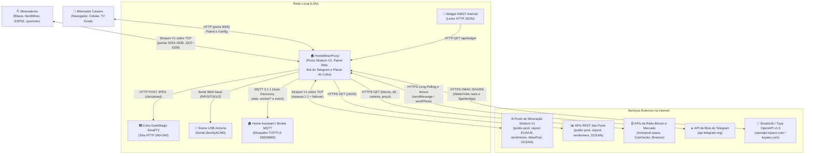
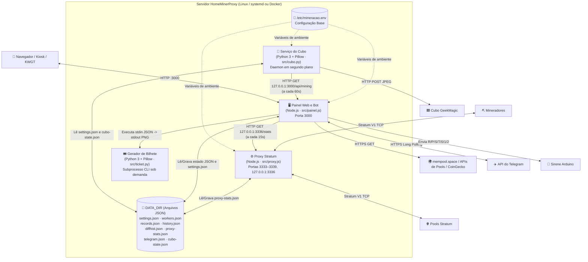
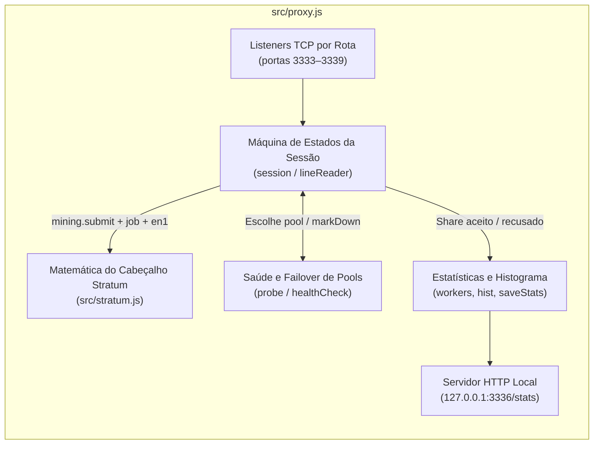
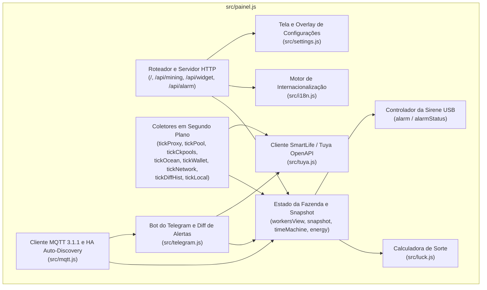
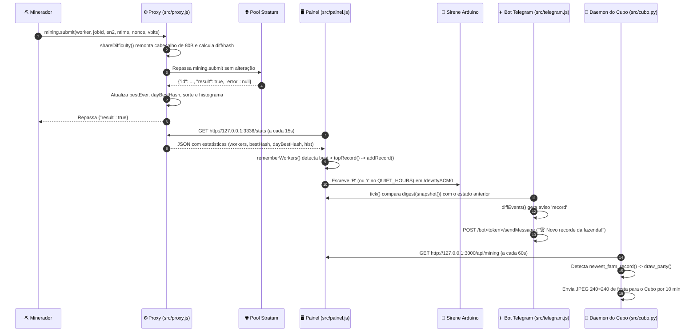
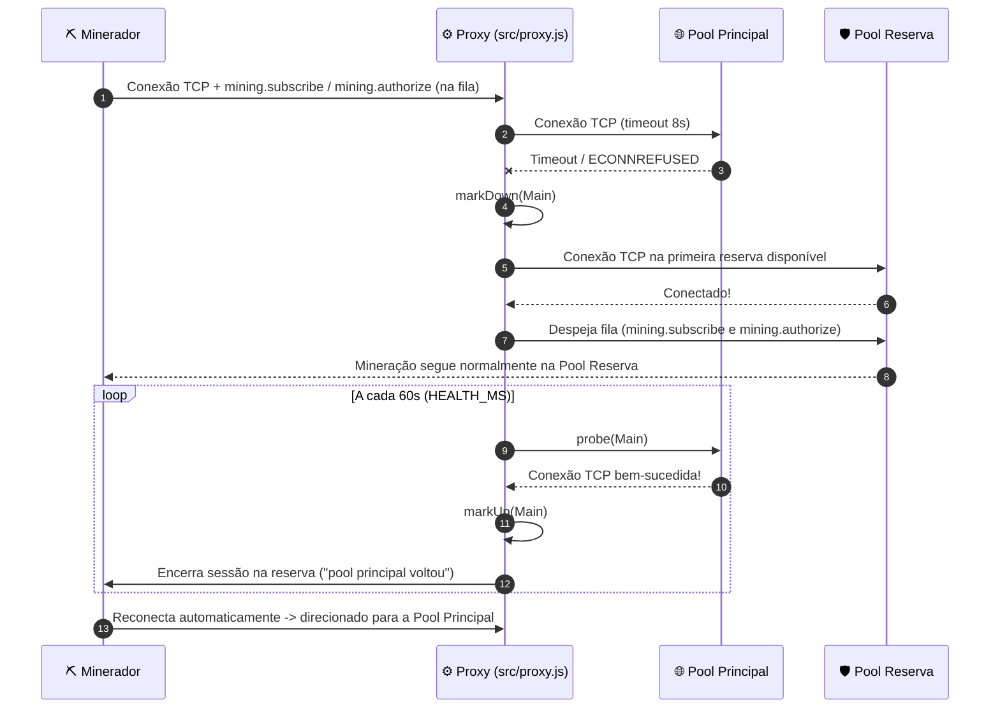

# 🏗️ Arquitetura — Modelo C4 (HomeMinerProxy)

[English](README.md) · **Português**

Este documento descreve a arquitetura do **HomeMinerProxy** utilizando o **Modelo C4** (Contexto, Contêineres, Componentes e Fluxos Dinâmicos).

---

## Nível 1 — Contexto do Sistema (C1)

No nível mais alto, o **HomeMinerProxy** roda num pequeno servidor doméstico (Odroid, Raspberry Pi, host Docker ou qualquer Linux) entre os aparelhos de mineração da casa e as pools/APIs externas de Bitcoin, transformando a mineração solo numa experiência visual e interativa.

### Atores e Sistemas Externos
| Ator / Sistema | Protocolo | Papel |
|---|---|---|
| **Minerador Caseiro (Usuário)** | HTTP (`:3000`), Telegram | Acompanha o painel (computador, celular ou `?kiosk`), altera opções em `/config` e conversa com o bot do Telegram. |
| **Mineradores (Hardware)** | Stratum V1 TCP (`:3333–3339`) | Bitaxe, NerdMiner, ESP32 ou `cpuminer` (`minerd`) conectando-se ao servidor da casa em vez de direto na pool. |
| **Pools Stratum V1** | Stratum V1 TCP | Pools solo ou compartilhadas (`public-pool.io`, `solo.ckpool.org`, `eusolo.ckpool.org`, `pool.nerdminers.org`, `solo.atlaspool.io`, `mine.ocean.xyz`). |
| **APIs REST das Pools** | HTTPS JSON | Consulta complementar para workers que não passam pelo proxy ou para saldos da pool. |
| **APIs de Bitcoin e Mercado** | HTTPS JSON | `mempool.space` (últimos blocos, ajuste de dificuldade, taxas, histórico de dificuldade, saldo da carteira) e `CoinGecko` / `Binance` (cotação BTC/BRL e BTC/USD). |
| **API do Telegram** | HTTPS JSON / Multipart | Recebe comandos via *long polling* (`getUpdates`) e envia alertas e o PNG diário do bilhete de loteria (`sendMessage`, `sendPhoto`). |
| **Cubo GeekMagic SmallTV** | HTTP (`:80`) | Display de mesa 240×240 atualizado a cada 5 minutos (ou na hora quando sai novo recorde da fazenda) via upload JPEG. |
| **Sirene USB Arduino** | Serial USB (`9600 8N1`) | Toca melodias e controla os LEDs de estado (verde/amarelo/vermelho) a partir de comandos de 1 byte. |
| **Widget KWGT Android** | HTTP JSON (`:3000/api/widget`) | Lê as métricas resumidas e já formatadas pela rede Wi-Fi de casa ou VPN. |
| **Home Assistant / Broker MQTT** | MQTT 3.1.1 (`:1883` / `:8883`) | Recebe as entidades de Auto-Discovery (`homeassistant/.../config`), o estado da fazenda (`<prefixo>/state`), o estado de cada worker (`<prefixo>/worker/*`) e os eventos instantâneos (`<prefixo>/event`). |
| **SmartLife / Tuya OpenAPI v1.0** | HTTPS JSON (`HMAC-SHA256`) | Lê Watts, Volts, corrente (mA) e estado (ligada/desligada) de uma tomada inteligente SmartLife / Tuya a cada 30s e permite ligar, desligar ou reiniciar a tomada via `/tomada` ou watchdog automático. |

---

## Nível 2 — Contêineres (C2)

O **HomeMinerProxy** é composto por três serviços leves (gerenciados por `systemd` ou `docker compose`), um utilitário de linha de comando sob demanda e persistência em arquivos JSON locais.

### Inventário de Contêineres
| Contêiner | Runtime | Ponto de Entrada | Responsabilidade |
|---|---|---|---|
| **`mineracao-proxy`** | Node.js (>=16, sem deps) | [`src/proxy.js`](../../src/proxy.js) | Escuta nas portas `3333–3339`, repassa o tráfego Stratum V1 1:1, remonta o cabeçalho de 80 bytes para calcular dificuldade e hash de cada share, gerencia failover/failback de pools, persiste `proxy-stats.json` e expõe `http://127.0.0.1:3336/stats`. |
| **`mineracao-painel`** | Node.js (>=16, sem deps) | [`src/painel.js`](../../src/painel.js) | Serve a interface web bilíngue (`/`, `/config`) e APIs JSON (`/api/mining`, `/api/widget`, `/api/alarm`, `/api/config`), consulta o proxy local e APIs externas, aciona a sirene no Arduino e executa o bot do Telegram. |
| **`mineracao-cubo`** | Python 3 + Pillow | [`src/cubo.py`](../../src/cubo.py) | Consulta `/api/mining` a cada minuto, desenha o placar JPEG 240×240 a cada 5 minutos (ou a tela de comemoração por 10 minutos assim que sai novo recorde da fazenda) e faz o upload para o cubo GeekMagic. |
| **`ticket.py`** | Python 3 + Pillow | [`src/ticket.py`](../../src/ticket.py) | Chamado sob demanda pelo bot do Telegram (`src/telegram.js`) para renderizar o PNG 1080×1350 do bilhete de loteria do dia a partir do JSON de `/api/mining`. |
| **Armazenamento JSON (`DATA_DIR`)** | Sistema de arquivos | `/var/lib/mineracao` ou `/data` | Guarda `settings.json` (overlay da tela `/config`), `proxy-stats.json`, `workers.json`, `records.json`, `history.json`, `achievements.json`, `diffhist.json`, `telegram.json` e `cubo-state.json`. |

---

## Nível 3 — Componentes (C3)

### 3.1 Componentes do Proxy Stratum (`src/proxy.js` e `src/stratum.js`)

- **[`src/stratum.js`](../../src/stratum.js)**: Matemática criptográfica pura (`sha256d`, `swap32`, `shareDifficulty`, `hashDifficulty`) que remonta a transação coinbase, Merkle root, máscara de versão (`BIP310`) e o cabeçalho de 80 bytes do bloco para calcular a dificuldade exata atingida e o hash no formato dos exploradores.
- **Máquina de Estados da Sessão (`session` em [`src/proxy.js`](../../src/proxy.js))**: Enfileira as mensagens iniciais do minerador até a conexão com a pool abrir, acompanha `mining.subscribe` (`extranonce1`), `mining.configure` (`version-rolling.mask`), `mining.notify` (até 32 jobs ativos), `mining.set_difficulty` e correlaciona cada `mining.submit` com a resposta da pool.
- **Gerenciador de Saúde e Failover (`healthCheck`, `probe`)**: Marca pools que não respondem como fora do ar, direciona os mineradores para as pools reserva sem alterar o endereço de pagamento, testa as pools caídas a cada 60s e encerra as sessões na reserva quando a principal volta para forçar a reconexão na principal.

### 3.2 Componentes do Painel e Bot (`src/painel.js` e módulos)

- **[`src/painel.js`](../../src/painel.js)**: Orquestrador principal, loops de coleta (`every`), agregação de estado (`workersView`, `snapshot`), controle serial do Arduino (`alarm`) e SPA HTML/CSS/JS embutida.
- **[`src/luck.js`](../../src/luck.js)**: Modelo estatístico (`luckOf`, `theoreticalShare`), motor do campeonato semanal (`weekKey`, `weeklyStandings`) e motor de conquistas da fazenda (`ACHIEVEMENTS`, `evaluateAchievements`).
- **[`src/i18n.js`](../../src/i18n.js)**: Seleção de idioma (`?lang` > cookie `lang` > variável `LANGUAGE` > `Accept-Language` > `'en'`) e tradução determinística PT -> EN da página (`localizePage`).
- **[`src/settings.js`](../../src/settings.js)**: Renderiza `/config`, valida os campos (`clean`, incluindo mapas por worker de `WATTS` e `EXPECTED`, configurações MQTT e Tuya), verifica o `SETTINGS_PIN` em tempo constante via SHA-256 com bloqueio contra força bruta (`checkPin`), grava `settings.json`, exporta/restaura backups completos da fazenda (`exportBackup`, `restoreBackup`) e testa a comunicação com o Cubo, o Telegram, o broker MQTT e a tomada Tuya.
- **[`src/telegram.js`](../../src/telegram.js)**: Cliente de *long polling* (`getUpdates`), motor de detecção de eventos (`digest`, `diffEvents`), tratamento de comandos (`/status`, `/workers`, `/sorte`, `/recordes`, `/campeonato`, `/conquistas`, `/tomada`, `/bilhete`, `/ajuda`) e integração via subprocesso com `src/ticket.py`.
- **[`src/mqtt.js`](../../src/mqtt.js)**: Cliente MQTT 3.1.1 sem dependências sobre `net`/`tls` (`connectPacket`, `publishPacket`, `testBroker`, `start`), gerador de Home Assistant Auto-Discovery (`discoveryConfigs`), publicador de estado (`statePayload`) e publicador de eventos instantâneos reaproveitando `digest`/`diffEvents`.
- **[`src/tuya.js`](../../src/tuya.js)**: Cliente Tuya OpenAPI v1.0 sem dependências (`signRequest`, `parseStatus`, `createClient`, `testPlug`) para ler consumo real (Watts, Volts, mA, ligada/desligada) e ligar, desligar ou reiniciar uma tomada inteligente SmartLife.

---

## Nível 4 — Fluxos Dinâmicos (C4)

### 4.1 Envio de Share e Comemoração de Novo Recorde da Fazenda

### 4.2 Failover de Pool e Retorno Automático (Failback)

